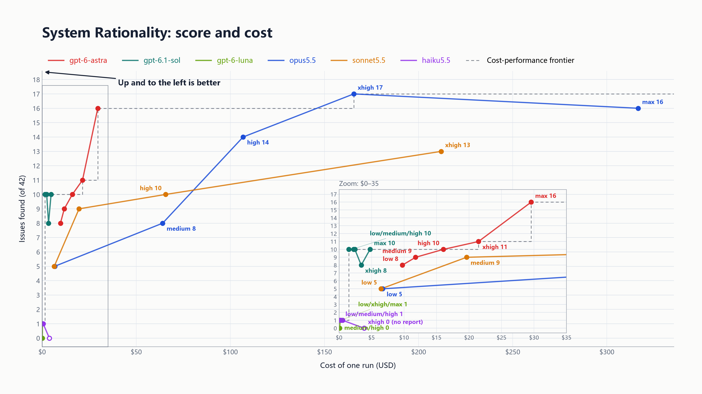

  <strong>English</strong> · <a href="README.zh-CN.md">简体中文</a>

# System Rationality Benchmark

Can a model find the serious design problems in a real software project?

## Current results

- **Round:** 3 (runs finished 2026-10-09)
- **Coverage:** 6 models · 28 runs · 42 scoring items
- **Data:** [`data/round3-results.csv`](data/round3-results.csv) · charts in PNG and SVG under [`charts/`](charts/)

## How it works

- The model reads the source code of a real Windows system utility. The project is open source, and was written after the models' training cutoffs. The tested version contains serious design problems: some were placed on purpose, the others are real problems found and confirmed during the pilot.
- The task is to report the serious design problems. Fixing them is not required.
- A report scores one point for each scoring item it hits, judged against written criteria. A problem counts only once, however often it is mentioned.
- Claude models run in Claude Code, GPT models in the Codex CLI, each in its own container with the same prompt.
- Cost is recomputed from each run's token counts at the official API list prices (read 2026-10-09). Time is the run's wall-clock time.

## Limits

- One run per configuration, so a single result can move by a few items between runs.
- sonnet5.5 and haiku5.5 were not run at max. haiku5.5 at xhigh ended without a report and counts as 0.
- The scoring items, the reports and the tested source are not published, so that the test stays usable.
