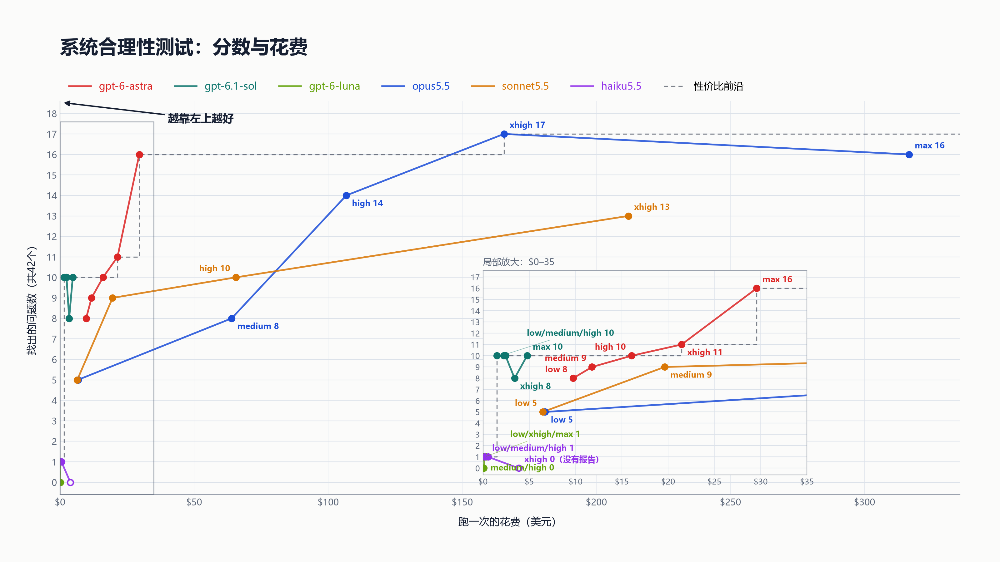

  <a href="README.md">English</a> · <strong>简体中文</strong>

# 系统合理性测试

模型能不能找出一个真实软件项目里的严重设计问题？

## 当前结果

- **轮次：** 第三轮（2026-10-09 跑完）
- **覆盖：** 6个模型 · 28次运行 · 42个评分项
- **数据：** [`data/round3-results.csv`](data/round3-results.csv) · 图表的PNG和SVG在 [`charts/`](charts/)

## 怎么测

- 模型读一个真实的Windows系统工具的源码。项目是开源的，写于这些模型的训练截止日期之后。被测版本里有严重的设计问题：一部分是有意放进去的，其余是试点过程中发现并核实的真实问题。
- 任务是报告严重的设计问题，不要求修复。
- 报告每命中一个评分项得1分，按写好的命中标准判定。同一个问题无论提到几次只算一次。
- Claude模型在Claude Code里跑，GPT模型在Codex CLI里跑，各自在独立容器中，提示词相同。
- 花费按每次运行的token数和官方API价格（2026-10-09读取）重算；时间是运行的实际耗时。

## 局限

- 每个配置只跑了一次，单次结果在不同运行之间可能差几项。
- sonnet5.5和haiku5.5没有跑max。haiku5.5的xhigh没有写出报告，按0分计。
- 评分项、模型报告和被测源码不公开，以免测试失效。
